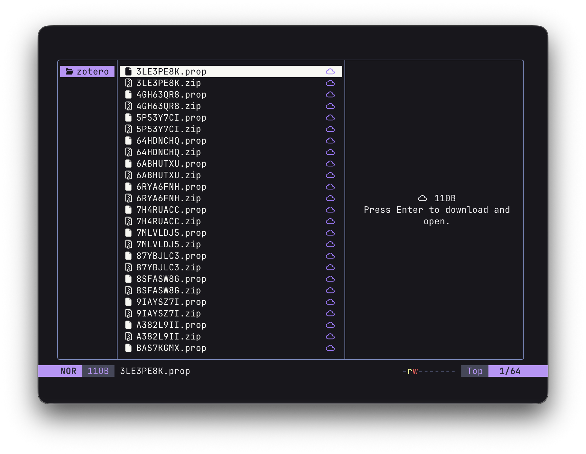

# cloudfiles.yazi

Stop [Yazi](https://github.com/sxyazi/yazi) from downloading your whole cloud
drive just because you scrolled past it.



On macOS, sync apps like SeaDrive, iCloud Drive, Dropbox, OneDrive and Google
Drive show files that aren't on your Mac yet as placeholders. Opening one, or
even reading a single byte of it, downloads it. Out of the box, Yazi reads
every file it shows (to work out its type and draw a preview), so browsing a
synced folder downloads everything on screen, or hangs when the sync app is
offline.

With this plugin:

- Files that are only in the cloud show a cloud icon in the file list and are never read
  while you browse.
- Hovering one shows its size instead of a preview.
- Pressing Enter downloads it in the background (a download icon in the list, a counter
  in the status bar), then opens it. You can keep browsing meanwhile.
- Trashing a cloud file from an app like SeaDrive deletes it without downloading
  it, and the sync app's own trash keeps it.
- Downloaded files preview and open exactly as they normally would.

## Requirements

- macOS

## Installation

```sh
ya pkg add IKA3RUS/cloudfiles
```

## Usage

Add this to your `init.lua`:

```lua
require("cloudfiles"):setup()
```

Or customize it:

```lua
require("cloudfiles"):setup {
	nerd_font = true,    -- false if your font has no Nerd Font icons
	icon = "󰅣",          -- marker for files that are only in the cloud
	downloading = "󰅢",   -- marker while a file downloads
	color = "blue",      -- color of the markers and the status bar counter
	center = false,      -- center the preview of cloud-only files
	order = 500,         -- position of the marker in the file list
	status_order = 500,  -- position of the counter in the status bar
}
```

The markers use [Nerd Font](https://www.nerdfonts.com) icons, like Yazi's own
file icons. If you see boxes or question marks instead, set
`nerd_font = false` to use ○ and ◐.

Add this to your `yazi.toml`, so the plugin handles the folders your sync apps
use:

```toml
[[plugin.prepend_fetchers]]
url   = "**/Library/CloudStorage/**"
run   = "cloudfiles"
group = "mime"
prio  = "high"

# iCloud Drive
[[plugin.prepend_fetchers]]
url   = "**/Library/Mobile Documents/**"
run   = "cloudfiles"
group = "mime"
prio  = "high"

[[plugin.prepend_previewers]]
mime = "cloud/*"
run  = "cloudfiles"
```

And this to your `keymap.toml`, so opening a file downloads it first and
trashing works on cloud files:

```toml
[[mgr.prepend_keymap]]
on   = "<Enter>"
run  = "plugin cloudfiles"
desc = "Open (download cloud files first)"

[[mgr.prepend_keymap]]
on   = "o"
run  = "plugin cloudfiles"
desc = "Open (download cloud files first)"

[[mgr.prepend_keymap]]
on   = "O"
run  = "plugin cloudfiles -- --interactive"
desc = "Open interactively (download cloud files first)"

[[mgr.prepend_keymap]]
on   = "d"
run  = "plugin cloudfiles -- trash"
desc = "Trash selected files (delete cloud files)"
```

For files that are already on your Mac these keys do exactly what Yazi
normally does, so it's safe to bind them everywhere.

## Notes

- The counter shows how many files are downloading, not how far along they
  are. Sync apps only hand over a file once all of it has arrived.
- A failed download is retried after 1, 1, 1, 10, 30 and 60 seconds, since
  sync apps sometimes refuse the first tries. If it still fails (for example, the sync
  app is offline), the file keeps its cloud icon and you get a notification.
- Some sync apps, like SeaDrive, keep their trash on the server, and macOS
  can't move a cloud file into your Mac's Trash without downloading it (Finder
  downloads it first). With `d`, such cloud files, and folders containing
  them, are deleted instead. The deletion reaches the server, where the sync
  app's own trash keeps them for as long as it's set up to. Everything else,
  and cloud files from apps that can trash them, like iCloud Drive, still goes
  to your Trash. The confirmation tells you when this may happen.
- Only the keys above download in the background. Opening a cloud file any
  other way, such as double-clicking it, lets macOS download it first while
  Yazi waits.
- If you free up space on a file ("Remove Download" in Finder) while Yazi is
  running, Yazi may not notice. Restart Yazi before previewing that file, or
  the preview may download it again.

## Tested on

- macOS 27.0.1 on Apple silicon
- Yazi 26.9.1 (Homebrew)
- SeaDrive
- Ghostty

## AI attribution

This project was developed with AI assistance.

<div style="display: flex; align-items: center; white-space: nowrap; gap: 0.5rem; padding: 8px;">
  <div style="font-family: IBM Plex Sans; font-weight: 400; font-size: 16px; line-height: 22px; letter-spacing: 0px;">
    <a rel="noopener noreferrer" href="https://aiattribution.github.io/statements/AIA-PAI-CeNc-HinAin-Nr-?model=Claude%20Opus%205.5-v1.0" data-cy="recommended-attribution-statement-text" target="_blank" style="font-family: IBM Plex Sans; font-weight: 400; font-size: 16px; line-height: 22px; letter-spacing: 0px;">AIA PAI CeNc HinAin Nr Claude Opus 5.5 v1.0 </a>
  </div>
  <div style="display: flex; gap: 0.5rem;">
    <svg width="24" height="24" viewBox="0 0 24 24" fill="none" xmlns="http://www.w3.org/2000/svg">
      <g clip-path="url(#clip0_50_14)">
        <path d="M12 0C3.00001 0 -5.99999 12 6.00001 22L12 16L18 22C25 16 28 3 12 0Z" fill="#525252">
        </path>
        <path d="M12 23.5C18.3513 23.5 23.5 18.3513 23.5 12C23.5 5.64873 18.3513 0.5 12 0.5C5.64873 0.5 0.5 5.64873 0.5 12C0.5 18.3513 5.64873 23.5 12 23.5Z" stroke="#161616">
        </path>
        <path d="M13.6471 14.6L13.1471 12.94H10.8171L10.3171 14.6H8.77715L11.0771 7.61998H12.9571L15.2271 14.6H13.6471ZM11.9971 8.99998H11.9471L11.1771 11.65H12.7771L11.9971 8.99998Z" fill="white">
        </path>
      </g>
      <defs>
        <clipPath id="clip0_50_14">
          <rect width="24" height="24" fill="white">
          </rect>
        </clipPath>
      </defs>
    </svg>
    <svg width="24" height="24" viewBox="0 0 24 24" fill="none" xmlns="http://www.w3.org/2000/svg">
      <circle cx="12" cy="12" r="11.5" stroke="#161616">
      </circle>
      <path d="M14 7H8V8H14V7Z" fill="#161616">
      </path>
      <path d="M14 9H8V10H14V9Z" fill="#161616">
      </path>
      <path d="M11 11H8V12H11V11Z" fill="#161616">
      </path>
      <path d="M10 16H8V17H10V16Z" fill="#161616">
      </path>
      <path d="M18.8535 13.6465L17.3535 12.1465C17.3071 12.1001 17.252 12.0632 17.1913 12.0381C17.1307 12.0129 17.0657 12 17 12C16.9343 12 16.8693 12.0129 16.8087 12.0381C16.748 12.0632 16.6929 12.1001 16.6465 12.1465L12 16.7929V19H14.2071L18.8535 14.3535C18.9 14.3071 18.9368 14.252 18.9619 14.1913C18.9871 14.1307 19 14.0657 19 14C19 13.9343 18.9871 13.8693 18.9619 13.8087C18.9368 13.748 18.9 13.6929 18.8535 13.6465ZM13.7929 18H13V17.2071L15.5 14.7071L16.2929 15.5L13.7929 18ZM17 14.7929L16.2071 14L17 13.2071L17.7929 14L17 14.7929Z" fill="#161616">
      </path>
      <path d="M10 19H7C6.73487 18.9997 6.48068 18.8943 6.2932 18.7068C6.10572 18.5193 6.00028 18.2651 6 18V6C6.00028 5.73487 6.10572 5.48068 6.2932 5.2932C6.48068 5.10572 6.73487 5.00028 7 5H15C15.2651 5.00028 15.5193 5.10572 15.7068 5.2932C15.8943 5.48068 15.9997 5.73487 16 6V11H15V6H7V18H10V19Z" fill="#161616">
      </path>
    </svg>
    <svg width="24" height="24" viewBox="0 0 24 24" fill="none" xmlns="http://www.w3.org/2000/svg">
      <path d="M19 16.0002H17V14.0002H16V16.0002H14V17.0002H16V19.0002H17V17.0002H19V16.0002Z" fill="#161616">
      </path>
      <path d="M12 18.0002H8V6.00017H12V9.00017C12.0008 9.26515 12.1064 9.51906 12.2937 9.70643C12.4811 9.8938 12.735 9.99941 13 10.0002H16V12.0002H17V9.00017C17.0018 8.93446 16.9893 8.86913 16.9634 8.80871C16.9375 8.74828 16.8988 8.6942 16.85 8.65017L13.35 5.15017C13.306 5.10134 13.2519 5.06263 13.1915 5.03674C13.131 5.01084 13.0657 4.99836 13 5.00017H8C7.73502 5.00094 7.48111 5.10654 7.29374 5.29391C7.10637 5.48128 7.00077 5.73519 7 6.00017V18.0002C7.00077 18.2652 7.10637 18.5191 7.29374 18.7064C7.48111 18.8938 7.73502 18.9994 8 19.0002H12V18.0002ZM13 6.20017L15.8 9.00017H13V6.20017Z" fill="#161616">
      </path>
      <circle cx="12" cy="12" r="11.5" stroke="#161616">
      </circle>
    </svg>
    <svg width="24" height="24" viewBox="0 0 24 24" fill="none" xmlns="http://www.w3.org/2000/svg">
      <path d="M18 17H16.5V16H18V8H16.5V7H18C18.2651 7.0003 18.5193 7.10576 18.7068 7.29323C18.8942 7.4807 18.9997 7.73488 19 8V16C18.9996 16.2651 18.8942 16.5193 18.7067 16.7067C18.5193 16.8942 18.2651 16.9996 18 17Z" fill="#161616">
      </path>
      <path d="M15.5 13C16.0523 13 16.5 12.5523 16.5 12C16.5 11.4477 16.0523 11 15.5 11C14.9477 11 14.5 11.4477 14.5 12C14.5 12.5523 14.9477 13 15.5 13Z" fill="#161616">
      </path>
      <path d="M12 13C12.5523 13 13 12.5523 13 12C13 11.4477 12.5523 11 12 11C11.4477 11 11 11.4477 11 12C11 12.5523 11.4477 13 12 13Z" fill="#161616">
      </path>
      <path d="M8.5 13C9.05228 13 9.5 12.5523 9.5 12C9.5 11.4477 9.05228 11 8.5 11C7.94772 11 7.5 11.4477 7.5 12C7.5 12.5523 7.94772 13 8.5 13Z" fill="#161616">
      </path>
      <path d="M7.5 17H6C5.73488 16.9997 5.4807 16.8942 5.29323 16.7068C5.10576 16.5193 5.0003 16.2651 5 16V8C5.00026 7.73486 5.10571 7.48066 5.29319 7.29319C5.48066 7.10571 5.73486 7.00026 6 7H7.5V8H6V16H7.5V17Z" fill="#161616">
      </path>
      <circle cx="12" cy="12" r="11.5" stroke="#161616">
      </circle>
      <circle cx="12" cy="12" r="11.5" stroke="#161616">
      </circle>
    </svg>
    <svg width="24" height="24" viewBox="0 0 24 24" fill="none" xmlns="http://www.w3.org/2000/svg">
      <path d="M14.5 16H9.49999V17H14.5V16Z" fill="#161616">
      </path>
      <path d="M13.5 18H10.5V19H13.5V18Z" fill="#161616">
      </path>
      <path d="M12 5C10.6739 5 9.40214 5.52678 8.46446 6.46447C7.52678 7.40215 6.99999 8.67392 6.99999 10C6.96618 10.7267 7.10538 11.451 7.40614 12.1133C7.7069 12.7757 8.16063 13.3572 8.72999 13.81C9.22999 14.275 9.49999 14.54 9.49999 15H10.5C10.5 14.08 9.94499 13.565 9.40499 13.07C8.93767 12.7121 8.56523 12.2451 8.32028 11.7099C8.07534 11.1747 7.96536 10.5876 7.99999 10C7.99999 8.93913 8.42142 7.92172 9.17157 7.17157C9.92171 6.42143 10.9391 6 12 6C13.0609 6 14.0783 6.42143 14.8284 7.17157C15.5786 7.92172 16 8.93913 16 10C16.034 10.588 15.9233 11.1754 15.6775 11.7107C15.4316 12.2459 15.0582 12.7127 14.59 13.07C14.055 13.57 13.5 14.07 13.5 15H14.5C14.5 14.54 14.765 14.275 15.27 13.805C15.839 13.353 16.2925 12.7724 16.5932 12.1109C16.894 11.4494 17.0334 10.7259 17 10C17 9.34339 16.8707 8.69321 16.6194 8.08658C16.3681 7.47995 15.9998 6.92876 15.5355 6.46447C15.0712 6.00017 14.52 5.63188 13.9134 5.3806C13.3068 5.12933 12.6566 5 12 5Z" fill="#161616">
      </path>
      <circle cx="12" cy="12" r="11.5" stroke="#161616">
      </circle>
    </svg>
    <svg width="24" height="24" viewBox="0 0 24 24" fill="none" xmlns="http://www.w3.org/2000/svg">
      <circle cx="12" cy="12" r="11.5" stroke="#161616">
      </circle>
      <path d="M10 6C10.4945 6 10.9778 6.14662 11.3889 6.42133C11.8 6.69603 12.1205 7.08648 12.3097 7.54329C12.4989 8.00011 12.5484 8.50277 12.452 8.98773C12.3555 9.47268 12.1174 9.91814 11.7678 10.2678C11.4181 10.6174 10.9727 10.8555 10.4877 10.952C10.0028 11.0484 9.50011 10.9989 9.04329 10.8097C8.58648 10.6205 8.19603 10.3 7.92133 9.88893C7.64662 9.4778 7.5 8.99445 7.5 8.5C7.5 7.83696 7.76339 7.20107 8.23223 6.73223C8.70107 6.26339 9.33696 6 10 6ZM10 5C9.30777 5 8.63108 5.20527 8.0555 5.58986C7.47993 5.97444 7.03133 6.52107 6.76642 7.16061C6.50151 7.80015 6.4322 8.50388 6.56725 9.18282C6.7023 9.86175 7.03564 10.4854 7.52513 10.9749C8.01461 11.4644 8.63825 11.7977 9.31718 11.9327C9.99612 12.0678 10.6999 11.9985 11.3394 11.7336C11.9789 11.4687 12.5256 11.0201 12.9101 10.4445C13.2947 9.86892 13.5 9.19223 13.5 8.5C13.5 7.57174 13.1313 6.6815 12.4749 6.02513C11.8185 5.36875 10.9283 5 10 5Z" fill="#161616">
      </path>
      <path d="M15 19H14V16.5C14 15.837 13.7366 15.2011 13.2678 14.7322C12.7989 14.2634 12.163 14 11.5 14H8.5C7.83696 14 7.20107 14.2634 6.73223 14.7322C6.26339 15.2011 6 15.837 6 16.5V19H5V16.5C5 15.5717 5.36875 14.6815 6.02513 14.0251C6.6815 13.3687 7.57174 13 8.5 13H11.5C12.4283 13 13.3185 13.3687 13.9749 14.0251C14.6313 14.6815 15 15.5717 15 16.5V19Z" fill="#161616">
      </path>
      <path d="M19.9592 9.99025L19.3932 9.42432L17.938 10.8796L16.4827 9.42432L15.9167 9.99025L17.372 11.4455L15.9167 12.9008L16.4827 13.4667L17.938 12.0115L19.3932 13.4667L19.9592 12.9008L18.5039 11.4455L19.9592 9.99025Z" fill="#161616">
      </path>
    </svg>
  </div>
</div>

## License

This plugin is MIT-licensed. For more information check the [LICENSE](LICENSE) file.
